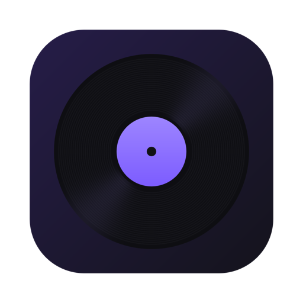

# DJ Crate



> **[ADRIAN: intro]**

Website: https://adriatogi.github.io/DJ-Crate/

---

## Download

**[Download the latest release](https://github.com/Adriatogi/DJ-Crate/releases/latest)** (`.zip`). Requires **macOS 13 or later** on an **Apple Silicon** Mac. Intel Macs: see [For developers](#for-developers).

1. Unzip it and drag **DJ Crate.app** into **Applications**.
2. Open it. The first time, macOS says *"Apple could not verify 'DJ Crate' is free of malware…"*. Click **Done**.
3. Open **System Settings → Privacy & Security**, scroll down, click **Open Anyway** next to DJ Crate and enter your password. You only do this once.

If macOS asks for Keychain access (where your Spotify login is stored), click **Always Allow**.

**Updating:** DJ Crate tells you when a new version is out; download it and replace the app. Your music and crates live outside the app and are never touched.

## First launch

1. **Create a library** (or **Open a folder…**, e.g. on an external SSD). This one folder holds every MP3 and DJ Crate's data. It's what Rekordbox imports and what you copy to a new Mac. By default the app puts new libraries in `~/Music/DJ Crate`.
2. **Connect Spotify** (once, ~2 minutes, needs **Spotify Premium**):
   1. Go to [developer.spotify.com/dashboard](https://developer.spotify.com/dashboard) → **Create app**, any name, tick **Web API**.
   2. Redirect URI: `http://127.0.0.1:8765/callback` (exactly; Settings has a copy button).
   3. Paste the app's **Client ID** into **Settings → Spotify**, then **Log in to Spotify**.

**Why your own Spotify app?** Spotify only lets a hobby app's creator approve about 25 people by hand, and opening an app to everyone is only offered to registered companies with a large user base. So each DJ makes their own free app: it's just for you, takes about 2 minutes, and your login never leaves your Mac.

> Spotify only lets apps read playlists **you own or collaborate on**, plus Liked Songs. For anyone else's, copy its songs into a new playlist of your own and import that.

**Several people on one Mac:** each library is separate (music, crates, sets and Spotify login). Switch by clicking the library name in the top bar. Someone sharing your Spotify developer app must be added under **User Management** in your Spotify dashboard.

**Open the Docs tab in the app** for how everything works.

## With Rekordbox

DJ Crate gets the music and tracks your prep; Rekordbox analyses, sets cues and plays. They share one music folder and talk only through XML files. DJ Crate **never touches Rekordbox's database**.

- **New downloads:** drag the library folder (or new files) into Rekordbox's Collection. After editing a song's title or artists in DJ Crate, right-click it in Rekordbox → **Reload Tag**.
- **BPM, key and My Tags in:** in Rekordbox, File → **Export Collection in xml format**, then pick that file in **Settings → Rekordbox**. Export again over the same file after changes. My Tags are read-only and need Rekordbox's setting that adds My Tags to Comments.
- **Crates and sets out:** turn on **Settings → Rekordbox → Send crates & sets**. Only playlists are sent, never BPM, key, grids, cues or tags.
- **Don't rename or move MP3s in Finder.** If a file goes missing, use **Relocate…** or **⋯ → Auto Relocate**.

The Docs tab has an FAQ with the step-by-step Rekordbox setup.

## Backups and a new Mac

Keep **two backups**: the **library folder** (MP3s + `.djcrate/`) and **Rekordbox's own backup** (File → Library → Backup Library: cues, grids, playlists, My Tags). DJ Crate also keeps daily database copies (last 14) in `.djcrate/backups/`.

On a new Mac: put the library folder at the **same path**, restore the Rekordbox backup, install DJ Crate and open the folder. Don't open one library from two Macs at once (e.g. a shared Dropbox folder).

## Troubleshooting

| Problem | Fix |
|---|---|
| Lots of download failures | **Settings → Update yt-dlp.** YouTube breaks downloaders every few weeks. |
| "Sign in to confirm you're not a bot" | **Settings → Use cookies from browser.** |
| "Video unavailable" | Removed or blocked in your country. Use a different link. |
| "JavaScript runtime" or "ffmpeg missing" | The app bundles both: reinstall DJ Crate. Developer installs: `brew install deno` / `brew install ffmpeg`, then **Re-check** in Settings. |
| Spotify `INVALID_CLIENT: Invalid redirect URI` | Add exactly `http://127.0.0.1:8765/callback` in your Spotify app. |
| "Not on this app's user list" | Spotify dashboard → your app → **User Management** → add the email. |
| "Port 8765 is in use" | Change `"port"` in `~/Library/Application Support/DJ Crate/config.json` and the redirect URI to match. |
| Anything else | **Settings → Open logs** and attach `djcrate.log` to a GitHub issue. |

## For developers

These build DJ Crate from source, need [Homebrew](https://brew.sh), and also work on Intel Macs.

**Install script:**

```bash
curl -fsSL https://raw.githubusercontent.com/Adriatogi/DJ-Crate/main/scripts/install.sh | bash
```

It adds `ffmpeg`, `uv` and `deno` if missing, clones the repo to `~/DJ-Crate`, and builds **DJ Crate.app** there. Libraries made this way default to `~/DJ-Crate/Libraries/`, so **back up before deleting that folder**.

<details>
<summary>By hand</summary>

```bash
brew install ffmpeg uv deno       # deno: skip if you already have Node
git clone https://github.com/Adriatogi/DJ-Crate.git ~/DJ-Crate
cd ~/DJ-Crate && uv sync
scripts/make_app.sh               # or run directly: uv run python -m djcrate.main
```
</details>

**Update:** `~/DJ-Crate/scripts/update.sh`. It rolls back if anything fails, and never touches your music or crates.

**Development:**

```bash
uv sync
uv run python -m djcrate.main            # app window
uv run python -m djcrate.main --browser  # in your browser (dev tools)
uv run python -m djcrate.main --fresh-start  # like a brand-new install (throwaway temp data; quit DJ Crate first)
uv run python -m djcrate.main --fake-update 9.9.9  # pretend a new version is out (see the update banner)
uv run pytest
```

Python 3.12–3.13, FastAPI on `127.0.0.1:8765` in a pywebview window, SQLite at `<library>/.djcrate/djcrate.db`, yt-dlp + ffmpeg + mutagen for downloads and tags. The frontend is plain JS modules in `djcrate/web/` with no build step. The website lives in `site/` and deploys to GitHub Pages.

**Releasing:** bump `__version__` in `djcrate/__init__.py`, add a `CHANGELOG.md` section, commit, `git tag vX.Y.Z && git push --tags`; GitHub Actions builds the app and publishes the release. To build the app on your own Mac: `scripts/build_release.sh && scripts/smoke_release.sh dist/DJ-Crate-*-arm64.zip`.

## Support

> **[ADRIAN: support pitch]**

[](https://buymeacoffee.com/ADRIAN-LINK)

## License

GPL-3.0-or-later. See [LICENSE](LICENSE).

DJ Crate only downloads links you choose. Downloading from YouTube may break YouTube's terms of service; use it for music you have the right to use.
